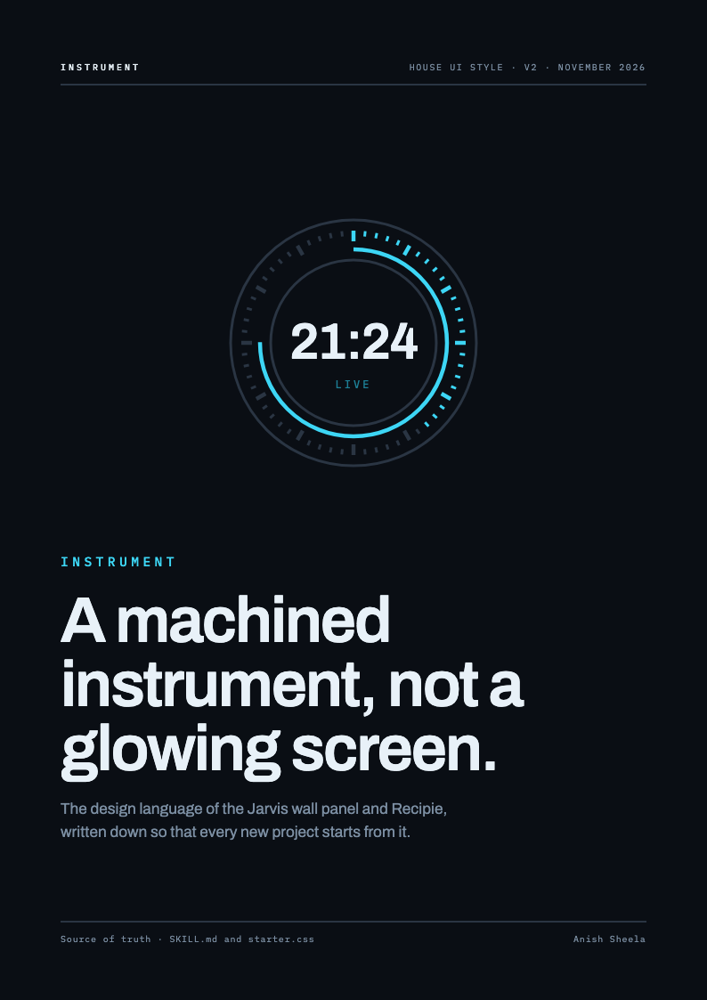
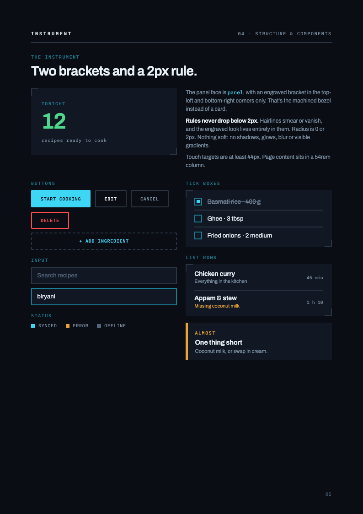

# Instrument

A dark UI style built like a machined instrument, not a glowing sci-fi screen,
packaged as a Claude Code skill
so that Claude designs in it without being told the rules each time.

It began as the Iron Man HUD brief for a wall panel
([Jarvis](https://github.com/anishanilkumar/jarvis)) and is now the house style
of a dozen small apps, among them [Recipie](https://github.com/anishanilkumar/recipie).
The design keeps the brief and drops the usual way of doing it: no hairlines, hex
grids, particles or glow. What's left is engraved corner brackets, 2px rules,
index ticks, two accent temperatures and big, honest numbers.

<p>
  
  
</p>

## The short version

- **The display never lies.** Data that may be old looks old and stops counting.
- **Motion means something changed.** At rest, at most one thing moves.
- **Every colour has a job.** Arc-blue is live, gold is attention, red is the one
  worst state.
- **Brackets, not boxes.** Two engraved corners on a raised panel; radius 0 or 2px.
- **Nothing below the type floor**, and no rule thinner than 2px.
- **Self-hosted fonts**, and an offline state that is designed, not an error page.

The full rules, with the reasoning, are in
[`skills/instrument-design/SKILL.md`](skills/instrument-design/SKILL.md). The
same thing set as a seven-page guide is
[`instrument-design.pdf`](skills/instrument-design/instrument-design.pdf).

## What's in the skill

| File | |
|---|---|
| `SKILL.md` | The rules as Claude reads them: palette, type, structure, components, motion, states, charts, voice |
| `starter.css` | Tokens, type roles, the bracketed panel and the shared components, at phone / web scale |
| `wall.css` | The scale for a fixed display read from 2 m |
| `charts.css` | Chart marks, series colours, legend and tooltip |
| `fonts/` | Archivo, IBM Plex Mono and Manjari, with their licences |
| `lint.sh` | Checks stylesheets for the slips a pattern can catch |
| `guide.html`, `instrument-design.pdf` | The printed guide |

## Install

For every project on your machine:

```sh
git clone https://github.com/anishanilkumar/instrument-design.git
ln -s "$PWD/instrument-design/skills/instrument-design" ~/.claude/skills/instrument-design
```

For one project, link or copy the same folder into that project's
`.claude/skills/` instead. Claude loads the skill when it is about to design or
style UI in a project that uses these tokens, or when you ask for the
instrument style.

The skill reads an optional `LOCAL.md` next to `SKILL.md`: a place for your own
machine's reference projects and for the projects it should leave alone. It is
git-ignored.

## Use it without Claude

The stylesheets stand on their own:

```html
<link rel="stylesheet" href="starter.css">
<body>
  <main class="page">
    <header class="topbar">
      <span class="wordmark">Departures</span>
      <span class="pill"><i class="dot"></i>Live</span>
    </header>
    <section class="instrument">
      <span class="label">Line 2 · Harbour</span>
      <div class="hero" style="color: var(--arc)">3 min</div>
      <span class="stamp">Updated 21:22</span>
    </section>
  </main>
</body>
```

Copy `fonts/` to the site root, or change the URLs at the top of `starter.css`.

## Check a project

```sh
skills/instrument-design/lint.sh path/to/src        # phone / web, 12px floor
FLOOR_PX=16 skills/instrument-design/lint.sh src    # wall display
```

`FAIL` lines break a rule (a 1px border, a rounded card, a shadow, pure black,
a font CDN, type below the floor). `WARN` lines need a look. A line that breaks
a rule on purpose carries the comment `instrument-lint: ok` and its reason.

## Rebuild the guide

From `skills/instrument-design/`:

```sh
chrome --headless --no-pdf-header-footer --print-to-pdf=instrument-design.pdf guide.html
```

## Licence

MIT for the text, CSS and script; see [LICENSE](LICENSE). The fonts are under
the SIL Open Font License 1.1, with their licence files in
[`skills/instrument-design/fonts/`](skills/instrument-design/fonts/).
